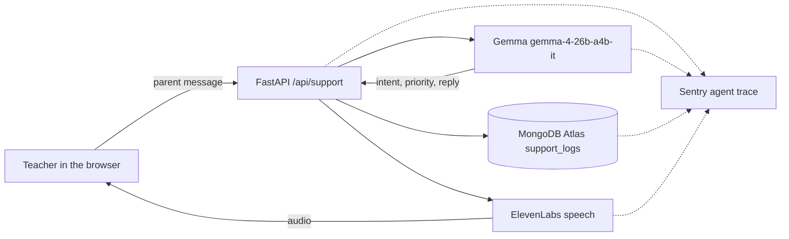

https://github.com/user-attachments/assets/9c15dcf5-bce3-4ca5-bf73-991dbb97e13b
# OmniCall

Built for a friend who teaches evening classes. Parents message about fees, class links, and cancellations while class is running. The teacher pastes the message, hears how urgent it is, and hears a reply they can send back.

Gemma, hosted by Google, reads the message. MongoDB Atlas keeps the calls. ElevenLabs speaks the reply. Sentry records the agent trace.

## Demo

[Watch the walkthrough](https://youtu.be/Uakq0zQBerw)

## Architecture

The teacher pastes a parent message in the browser. FastAPI sends it to the agent. Gemma decides the topic, priority, and the words to say. Atlas stores the call, ElevenLabs speaks those words, and the page plays the audio.




## Run

Open [http://127.0.0.1:8000/](http://127.0.0.1:8000/) after the server starts.

### Windows

```powershell
python -m venv .venv
.\.venv\Scripts\python.exe -m pip install -r requirements.txt
.\.venv\Scripts\python.exe main.py
```

### Mac

```bash
python3 -m venv .venv
source .venv/bin/activate
pip install -r requirements.txt
python main.py
```

## Results

A parent message, “The class link is not working and my child cannot join,” was run through the page.

The UI showed: “This is about the class link. high priority.” The spoken reply was: “I’m sorry the link isn’t working. Please try refreshing your browser or check your email for a new link.” The call was saved.


The Sentry conversation for that run is “Class link not working for child.” It shows model `gemma-4-26b-a4b-it`, 1 model call, 232 tokens, 0 errors, and a cost under $0.01. The tools on the trace are `save_support_log` and `elevenlabs_tts`.


## Environment

Copy `.env.example` to `.env` and fill in the keys. Do not commit `.env`.

- `GEMINI_API_KEY` — Google AI Studio key. The app calls hosted `gemma-4-26b-a4b-it`, so no model is downloaded.
- `ELEVENLABS_API_KEY`
- `MONGO_URI`
- `SENTRY_DSN`

